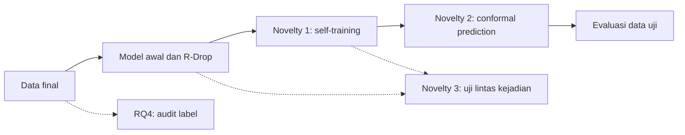

# SRL Tanpa Predikat pada Tweet Krisis Berbahasa Indonesia

**Checkpoint 2 · Kelompok 5**

Judul lengkap: *Semantic Role Labeling Tanpa Predikat pada Tweet Krisis Berbahasa Indonesia Menggunakan Self-Training Terkalibrasi Conformal Prediction*

Folder ini berisi notebook, laporan, dan slide Checkpoint 2. Penelitian ini mereproduksi SRL tanpa predikat dari Ariyanto dkk. [[1]](https://doi.org/10.1109/ACCESS.2025.3604068), lalu mengembangkannya melalui tiga novelty dan satu audit label. Model terbaik adalah IndoBERT self-training dengan macro-F1 tanpa O sebesar 0,7763 pada validasi dan 0,7644 pada data uji.

Folder `audit/`, `data/`, `hasil/`, dan `outputs/` disimpan di [Google Drive](https://drive.google.com/drive/folders/1Tg0fICq9zIalBb1N1KWVSW4J7jKz39xt?usp=drive_link). Cara memakainya dijelaskan pada bagian [Cara Menjalankan](#15-cara-menjalankan).

## 1. Latar Belakang

Saat bencana terjadi, warga sering membagikan lokasi, waktu, korban, dan kerusakan melalui Twitter. Informasi ini berguna bagi petugas, tetapi tweet ditulis pendek, tidak baku, dan sering tidak memiliki kata kerja. Metode seperti klasifikasi atau topic modeling hanya memberi satu label untuk seluruh tweet, sehingga rincian seperti lokasi dan jumlah korban tidak terambil.

Semantic role labeling (SRL) memberi label peran pada setiap kata. SRL berbasis PropBank memakai label umum seperti ARG0 dan ARG1 yang bergantung pada kata kerja. Oleh karena itu, Ariyanto dkk. [[1]](https://doi.org/10.1109/ACCESS.2025.3604068) mengembangkan SRL tanpa predikat yang memberi satu dari 15 label krisis pada setiap token. Pendekatan ini tetap dapat dipakai pada tweet tanpa kata kerja seperti "banjir di desa kalibuntu".

| Kelompok | Label | Contoh |
|:-|:-|:-|
| Kejadian nyata | `FLOOD-EVENT`, `EARTHQUAKE-EVENT`, `FIRE-EVENT`, `ACCIDENT-EVENT` | "banjir besar" |
| Bukan kejadian nyata | `FALSE-EVENT` | kata kejadian di dalam imbauan atau doa |
| Argumen | `PLACE-ARG`, `STREET-ARG`, `TIME-ARG`, `AFFECTEDOBJECTS-ARG`, `DEATHVICTIM-ARG`, `WOUNDVICTIM-ARG`, `OFFICER-ARG`, `REASON-ARG`, `INFORMATION-ARG` | "desa kalibuntu" sebagai `PLACE-ARG` |
| Lainnya | `O` | token tanpa peran krisis, misalnya "sejak" dan "di" |

## 2. Dari Penelitian Acuan ke Checkpoint 1

Penelitian acuan memakai 3.150 tweet latih berlabel, 1.000 tweet uji, dan 5.850 tweet tanpa label yang disebut pool. Model dilatih dengan self-training, yaitu model menebak label tweet di pool lalu tebakan tersebut dipakai sebagai pseudo-label. Tweet diterima jika rerata probabilitas tokennya melewati threshold 0,7, 0,8, atau 0,9. Dengan cara ini, IndoBERT mencapai F1 0,863.

Checkpoint 1 mereproduksi protokol tersebut. Hasilnya terlihat tinggi jika memakai F1 berbobot, tetapi jauh lebih rendah jika label O tidak dihitung.

| Model | F1 berbobot | Macro-F1 tanpa O |
|:-|:-:|:-:|
| Mayoritas (semua token ditebak O) | 0,564 | 0,000 |
| CRF | 0,878 | 0,672 |
| IndoBERT tanpa self-training | 0,903 | 0,738 |
| IndoBERT self-training, threshold 0,9 | 0,907 | 0,756 |

Sekitar 69% token berlabel O, sehingga F1 berbobot tetap tinggi walaupun banyak peran krisis belum dikenali. Model yang menebak semua token sebagai O saja sudah mendapat 0,564. Oleh karena itu, Checkpoint 2 memakai macro-F1 tanpa O sebagai metrik utama, yaitu rerata F1 dari 14 label peran dengan bobot yang sama. Angka 0,907 juga tidak dibandingkan langsung dengan 0,863 karena pembagian datanya berbeda.

## 3. Masalah yang Ditemukan

Reproduksi dan pemeriksaan awal menemukan enam masalah. Setiap masalah menjadi dasar satu perbaikan pada Checkpoint 2.

| No | Masalah | Bukti | Perbaikan |
|:-:|:-|:-|:-|
| 1 | Threshold tidak menyaring | Ketiga threshold akhirnya menerima seluruh 5.850 tweet pool | Novelty 1 |
| 2 | Isi validasi berubah | Data gabungan dibagi ulang setiap iterasi, sehingga pseudo-label dapat masuk validasi | Validasi tetap |
| 3 | Probabilitas belum dapat dipercaya | ECE token bukan O mencapai 0,117 sampai 0,136 | Novelty 2 |
| 4 | Epoch terbaik tidak stabil | Selisih epoch terbaik dengan epoch 15 paling besar 0,0054, jauh di bawah lebar CI 95% (0,062 sampai 0,073) | 15 epoch tetap |
| 5 | Jenis bencana baru belum diuji | Semua jenis kejadian ada di data latih, validasi, dan uji | Novelty 3 |
| 6 | Preprocessing dan anotasi | "KM" menjadi "kamu", "21.00" menjadi "0:21", serta `FLOOD-EVENT` dan `FALSE-EVENT` tertukar | Perbaikan data dan RQ4 |

ECE (Expected Calibration Error) mengukur selisih antara probabilitas model dan akurasinya. Nilai 0,12 berarti probabilitas yang diberikan model sekitar 12 poin lebih tinggi daripada akurasinya pada kata peran.

## 4. Pertanyaan Penelitian

| RQ | Pertanyaan | Ukuran |
|:-|:-|:-|
| RQ1 · Novelty 1 | Apakah self-training yang diperbaiki lebih baik daripada model awal dan R-Drop? | Macro-F1 tanpa O dan CI 95% bootstrap |
| RQ2 · Novelty 2 | Apakah conformal prediction mencapai cakupan 90%, berapa beban peninjauannya, dan sinyal mana yang paling baik mengurutkan tweet? | Cakupan, persentase tweet ditinjau, AURC |
| RQ3 · Novelty 3 | Seberapa baik model pada jenis bencana yang dikeluarkan dari data latih? | Macro-F1 11 label dan cakupan |
| RQ4 · Audit label | Apa pengaruh koreksi label yang disepakati dua penilai? | Cohen's kappa, macro-F1, dan cakupan |

## 5. Data

Dataset berasal dari Ariyanto dkk. [[2]](https://doi.org/10.1016/j.dib.2025.111688) dan memuat tweet tentang banjir, gempa, kebakaran, dan kecelakaan. Preprocessing bawaan diperbaiki terlebih dahulu agar arti kata tidak berubah. Penggantian dibuat satu token dengan satu token, sehingga pasangan kata dan label tidak bergeser.

| Perbaikan | Jumlah token |
|:-|:-:|
| Angka (jam, tanggal, jumlah) | 820 |
| Normalisasi kata tidak baku | 606 |
| Singkatan | 390 |
| Kata menempel | 238 |
| Typo | 220 |
| "KM" yang salah menjadi "kamu" | 77 |

Beberapa tweet juga dikeluarkan. Sebanyak 204 tweet membahas kejadian di luar Indonesia, 21 tweet latih tidak memiliki label kejadian, dan 1.048 tweet pool sangat mirip dengan data berlabel. Tweet pool yang mirip dikeluarkan agar tidak terjadi kebocoran data melalui pseudo-label.

| Bagian | Jumlah tweet | Fungsi |
|:-|:-:|:-|
| Data latih | 2.380 | melatih model |
| Validasi | 599 | memilih model, terdiri atas filter dev (198) dan stop dev (401) |
| Data uji | 946 | evaluasi akhir dan tidak dipakai untuk memilih model |
| Pool tanpa label | 5.424 | sumber pseudo-label |

## 6. Alur Penelitian



Setiap metode dilatih pada empat model bahasa dasar, yaitu IndoBERT, IndoBERTweet, IndoBERT IndoNLU, dan XLM-R. Setiap model dilatih tiga kali dengan seed 42, 43, dan 44, lalu reratanya dihitung. Selisih antarmodel diuji dengan bootstrap per tweet sebanyak 1.000 kali. Jika seluruh CI 95% berada di atas nol, model pertama konsisten lebih baik daripada model kedua.

## 7. Baseline: Model Awal dan R-Drop

Model awal memakai lapisan linear di atas subword pertama setiap kata. Pengaturannya dibuat sama untuk semua model bahasa dasar, sehingga perbedaan hasil berasal dari cara melatih dan bukan dari arsitektur.

| Pengaturan | Nilai |
|:-|:-|
| Optimizer | AdamW dengan learning rate 2×10⁻⁵ |
| Batch | 8 × akumulasi gradien 2 (setara 16) |
| Epoch | 15 dan tetap untuk semua model |
| Label smoothing | 0,1 |

F1 latih mencapai 0,979 sampai 0,996, sedangkan F1 validasi hanya sekitar 0,76. Kesenjangan sekitar 0,22 ini menunjukkan overfitting. Oleh karena itu, baseline kedua menambahkan R-Drop [[3]](https://arxiv.org/abs/2106.14448). R-Drop menjalankan tweet yang sama dua kali dengan dropout berbeda, lalu menambahkan selisih kedua prediksi ke dalam loss.

```
L = ½(CE₁ + CE₂) + β · ½[KL(P₁‖P₂) + KL(P₂‖P₁)],   β = 0,5
```

R-Drop selalu lebih tinggi daripada model awal. Namun, CI 95% yang seluruhnya positif hanya ditemukan pada IndoBERT (+0,0143) dan IndoBERTweet (+0,0077).

## 8. Novelty 1: Seleksi Pseudo-Label per Span

Rerata probabilitas tweet terbantu oleh token O yang mudah ditebak. Akibatnya, tweet dengan kata peran yang salah tetap lolos. Pada validasi, 64,0% tweet yang lolos threshold 0,7 masih memuat token salah. Novelty 1 mengganti seleksi per tweet dengan seleksi per span, yaitu rentang token berurutan dengan label yang sama.

1. **Lima model penyeleksi × 10 MC dropout.** Setiap token mendapat 50 suara. MC dropout berarti dropout tetap aktif saat prediksi, sehingga setiap tebakan sedikit berbeda.
2. **Skor token terlemah.** Setiap token diberi skor ternormalisasi (skor z) dari log probabilitas. Skor span diambil dari token dengan skor terkecil.
3. **Kuota per label.** Dari setiap label diambil 50% span terbaik dengan batas 2× porsinya di data asli. Kuota ini menjaga label jarang seperti `WOUNDVICTIM-ARG` tetap terwakili.
4. **Kesepakatan ≥ 0,9.** Span diterima jika sedikitnya 90% suara sepakat. Token O hanya diambil 35% dan harus berjarak lebih dari 2 token dari prediksi bukan O.
5. **Model ronde baru.** Model dilatih dari bobot pralatih dengan loss data asli ditambah 0,25 × loss pseudo-label.

| Aturan seleksi | Presisi pseudo-label | Cakupan label jarang |
|:-|:-:|:-:|
| Per tweet, threshold 0,9 | 0,932 | tidak dihitung |
| Per span, threshold 0,9 | 0,952 | 0,141 |
| Per span, kuota 50% | 0,943 | 0,325 |

Kuota dipilih karena presisinya tetap tinggi dan label jarang lebih banyak terwakili. Pada ablation, kuota juga menghasilkan macro-F1 validasi tertinggi (0,7763), sedangkan threshold 0,7 dan 0,8 justru berada di bawah R-Drop (0,7740).

| Model bahasa dasar | Awal | R-Drop | Self-training |
|:-|:-:|:-:|:-:|
| IndoBERT | 0,7597 | 0,7740 | **0,7763** |
| IndoBERTweet | 0,7497 | 0,7575 | 0,7625 |
| IndoBERT IndoNLU | 0,7516 | 0,7553 | 0,7662 |
| XLM-R | 0,7524 | 0,7585 | 0,7590 |

*Macro-F1 tanpa O pada validasi, rerata tiga seed.*

Self-training lebih tinggi daripada model awal pada keempat model bahasa dasar dengan selisih +0,0066 sampai +0,0165. Namun, tambahannya atas R-Drop hanya +0,0005 sampai +0,0110, dan CI yang seluruhnya positif hanya ditemukan pada IndoBERT IndoNLU. Learning curve R-Drop IndoBERT naik dari di bawah 0,68 (238 tweet) menjadi 0,7740 (2.380 tweet) dan belum mendatar, sehingga penambahan data berlabel manusia masih berpotensi menaikkan skor.

## 9. Novelty 2: Conformal Prediction

Novelty 2 menandai prediksi yang perlu diperiksa manusia. Conformal prediction [[4]](https://arxiv.org/abs/2107.07511) membentuk himpunan kandidat label untuk setiap token. Dengan α = 0,1, label benar ditargetkan masuk himpunan pada sedikitnya 90% token. Temperature scaling memang menurunkan ECE IndoBERT di stop dev dari 0,0517 menjadi 0,0242, tetapi tidak memberi jaminan cakupan seperti conformal prediction.

1. **Skor kalibrasi.** Pada data kalibrasi, setiap token diberi skor 1 − probabilitas label benar.
2. **Batas per label.** Skor diurutkan, lalu batas diambil pada urutan ke ⌈(n+1)(1−α)⌉ untuk setiap kelompok label. Label korban digabung karena contohnya sedikit.
3. **Himpunan label.** Label c masuk himpunan jika 1 − p(c) ≤ batas label c.
4. **Keputusan token.** Token diterima hanya jika himpunannya berisi satu label dan label itu sama dengan prediksi model. Token lainnya ditinjau.
5. **Keputusan tweet.** Tweet ditinjau jika sedikitnya satu tokennya ditinjau.

Aturan lama menerima token selama himpunannya berisi satu label. Aturan ini diperbarui karena himpunan {`FLOOD-EVENT`} dapat muncul saat model menebak O, sehingga token salah lolos tanpa tanda. Selain itu, enam sinyal ketidakpastian dibandingkan untuk mengurutkan tweet dari yang paling aman. Keenam sinyal tersebut adalah rerata probabilitas tweet, probabilitas token terendah, skor z, kesepakatan MC dropout, kesepakatan lima model, dan jumlah token yang ditandai conformal. Kualitas urutannya diukur dengan AURC, dan nilai yang lebih kecil berarti lebih baik.

| IndoBERT (validasi) | Awal | R-Drop | Self-training |
|:-|:-:|:-:|:-:|
| Cakupan token bukan O | 0,898 | 0,899 | 0,899 |
| Rerata ukuran himpunan | 1,257 | 1,461 | 1,497 |
| Tweet ditinjau | 82,0% | 85,7% | 87,5% |
| Tweet salah yang tertangkap | 90,4% | 92,5% | 93,8% |
| AURC skor z | 0,419 | 0,415 | 0,383 |

Cakupan berada di sekitar target, yaitu 0,894 sampai 0,903 pada data uji untuk 12 model. Skor z menghasilkan AURC terkecil pada seluruh 12 model dan unggul 0,034 sampai 0,068 atas rerata probabilitas tweet. Pada validasi, skor z memungkinkan 23,8% tweet IndoBERT self-training diterima otomatis, sedangkan rerata probabilitas hanya menerima 17,4%. Hanya 9,3% dari seluruh tweet salah yang ikut diterima.

Namun, beban peninjauan masih tinggi, yaitu 77,7% sampai 99,2% tweet uji. Label sulit seperti `REASON-ARG` dan `INFORMATION-ARG` memiliki batas probabilitas hanya 0,01 sampai 0,06, sehingga himpunan sering berisi lebih dari satu label.

## 10. Novelty 3: Uji Lintas Jenis Kejadian

Novelty 3 meniru munculnya jenis bencana baru. Satu jenis kejadian dikeluarkan dari data latih berlabel dan stop dev, lalu model diuji pada tweet jenis tersebut. Proses ini diulang untuk keempat jenis kejadian (leave-one-event-type-out). Keempat label kejadian nyata digabung menjadi KEJADIAN NYATA, sehingga evaluasi memakai 11 label. Penggabungan ini dilakukan karena model tidak mungkin mengenal nama label yang tidak pernah dilihatnya.

| IndoBERT | Dalam domain | Jenis dikeluarkan | Selisih | F1 KEJADIAN NYATA |
|:-|:-:|:-:|:-:|:-:|
| Awal | 0,744 | 0,556 | −0,188 | 0,827 → 0,420 |
| R-Drop | 0,761 | 0,564 | −0,196 | 0,832 → 0,473 |
| Self-training | 0,761 | 0,489 | −0,273 | 0,839 → 0 |

Self-training turun paling besar. Penyeleksi yang tidak pernah melihat contoh kebakaran menghasilkan 381 token `FALSE-EVENT` dan tidak satu pun `FIRE-EVENT`, sehingga model ronde baru belajar dari kesalahan tersebut. Peran umum masih dikenali dengan baik, misalnya `PLACE-ARG` (0,879 sampai 0,885) dan `TIME-ARG` (0,849 sampai 0,861). Cakupan conformal juga turun menjadi 0,457 sampai 0,861 jika batas dihitung dari jenis lain. Setelah 50 tweet jenis baru ditambahkan ke data kalibrasi, cakupan naik menjadi 0,733 sampai 0,878, tetapi belum mencapai 0,9.

## 11. RQ4: Audit Label

Sebagian label manusia ternyata tidak konsisten. Audit dilakukan untuk mengukur pengaruh koreksi label terhadap hasil evaluasi.

1. **Kandidat out-of-fold.** Data dibagi menjadi 5 fold, lalu setiap fold ditebak oleh model yang tidak dilatih dengan fold tersebut. Token yang labelnya berbeda dari tebakan menjadi kandidat salah label.
2. **Sampel penilaian.** Setiap bagian data memuat 190 kandidat ditambah sampel acak, yaitu 80 latih, 40 validasi, dan 50 uji.
3. **Penilaian buta.** Pada validasi dan uji, label asli dan prediksi ditampilkan sebagai opsi A/B acak agar penilai tidak mengetahui sumbernya.
4. **Koreksi.** Label hanya diubah jika kedua penilai sepakat.

Audit mengoreksi 530 token dalam 338 span. Cohen's kappa pada kandidat mencapai 0,880 sampai 0,969, sehingga berada di atas batas andal 0,8.

| IndoBERT dilatih dengan label audit | Uji dengan label asli | Uji dengan label audit |
|:-|:-:|:-:|
| Awal | 0,7544 | 0,7698 |
| R-Drop | 0,7577 | 0,7728 |
| Self-training | 0,7623 | 0,7775 |

Skor naik sekitar 0,015 pada kolom label audit walaupun prediksinya sama. Kenaikan ini berasal dari perbaikan kunci jawaban dan bukan dari model yang makin baik. Pada conformal, beban peninjauan uji IndoBERT self-training turun dari 79,5% menjadi 71,5%, tetapi cakupannya turun menjadi 0,892.

## 12. Hasil Akhir pada Data Uji

Model dipilih berdasarkan validasi, yaitu IndoBERT self-training. Data uji hanya dipakai untuk evaluasi akhir.

| Model bahasa dasar | Awal | R-Drop | Self-training |
|:-|:-:|:-:|:-:|
| IndoBERT | 0,7507 | 0,7608 | **0,7644** |
| IndoBERTweet | 0,7464 | 0,7553 | 0,7592 |
| IndoBERT IndoNLU | 0,7511 | 0,7481 | 0,7560 |
| XLM-R | 0,7529 | 0,7590 | 0,7665 |

*Macro-F1 tanpa O pada data uji, rerata tiga seed.*

Model terpilih turun 0,0119 dari validasi. XLM-R self-training memperoleh skor uji tertinggi, tetapi model tidak diganti karena pemilihan berdasarkan data uji membuat hasil terlalu optimistis. Kesalahan utama berupa argumen yang terlewat, misalnya `WOUNDVICTIM-ARG` ditebak O pada 46% kasus dan `REASON-ARG` pada 43% kasus. Self-training mengurangi argumen terlewat dari 405 menjadi 358 span, tetapi kesalahan status kejadian tetap 125 span.

## 13. Kesimpulan

| RQ | Jawaban |
|:-|:-|
| RQ1 | Self-training lebih baik daripada model awal (validasi +0,0066 sampai +0,0165, uji +0,0048 sampai +0,0137), tetapi tambahannya atas R-Drop kecil dan belum konsisten. |
| RQ2 | Cakupan berada di sekitar target 0,9. Skor z paling baik mengurutkan tweet dan memungkinkan 23,8% tweet diterima otomatis, tetapi 77,7% sampai 99,2% tweet uji masih perlu ditinjau. |
| RQ3 | Macro-F1 turun 0,188 sampai 0,273 pada jenis bencana baru, dan cakupan conformal turun di bawah 0,9. |
| RQ4 | Koreksi 530 token menaikkan macro-F1 uji IndoBERT self-training menjadi 0,7775 dan menurunkan beban peninjauan menjadi 71,5%, tetapi cakupan turun menjadi 0,892. |

Oleh karena itu, model lebih tepat dipakai sebagai alat bantu yang mengusulkan label, sedangkan manusia memeriksa tweet yang ditandai. Sebelum dipakai pada jenis bencana baru, model perlu dievaluasi dan dikalibrasi ulang dengan data berlabel dari jenis tersebut.

## 14. Isi Folder

| Berkas atau folder | Isi |
|:-|:-|
| `Checkpoint_2_Kelompok_5_final.ipynb` | notebook utama berisi data, training, evaluasi, dan pembahasan |
| `Laporan Penelitian Kelompok 5 CP2.docx` | laporan Checkpoint 2 (versi PDF: `Laporan Penelitian Kelompok 5.pdf`) |
| `Checkpoint 2 - Kelompok5.pptx` | slide presentasi |
| `srl_cp2/` | modul Python yang ditulis oleh notebook |
| `requirements.txt` | daftar library |
| `arsip/` | versi lama laporan dan slide |
| `data/` (Google Drive) | dataset Ariyanto dkk. (`1-Raw Data`, `2-Preprocessed Data`, `3-Labeled Data`) |
| `audit/` (Google Drive) | kandidat audit, prediksi out-of-fold, dan berkas penilaian Excel |
| `hasil/` (Google Drive) | split final, model, prediksi, hasil conformal, dan gambar |
| `outputs/` (Google Drive) | hasil Checkpoint 1 yang dibaca notebook |

Empat folder terakhir dapat diunduh dari [Google Drive](https://drive.google.com/drive/folders/1Tg0fICq9zIalBb1N1KWVSW4J7jKz39xt?usp=drive_link).

| Modul `srl_cp2/` | Fungsi |
|:-|:-|
| `praproses.py`, `data.py` | perbaikan preprocessing dan pembagian data |
| `encoding.py`, `models.py`, `training.py` | tokenisasi subword, model, training, dan R-Drop |
| `selftraining.py` | Novelty 1 |
| `konformal.py` | Novelty 2 |
| `lintas_kejadian.py` | Novelty 3 |
| `audit.py` | RQ4 |
| `evaluation.py`, `laporan.py`, `plotting.py` | metrik, bootstrap, tabel, dan gambar |

## 15. Cara Menjalankan

1. Instal PyTorch dengan CUDA sesuai GPU melalui [pytorch.org](https://pytorch.org/get-started/locally/), lalu instal library lainnya.

   ```powershell
   pip install -r requirements.txt
   ```

2. Unduh folder `audit`, `data`, `hasil`, dan `outputs` dari [Google Drive](https://drive.google.com/drive/folders/1Tg0fICq9zIalBb1N1KWVSW4J7jKz39xt?usp=drive_link), lalu letakkan di dalam folder `CP2-KEL5`.

3. Arahkan notebook ke folder hasil melalui variabel `CP2_HASIL`, lalu buka Jupyter atau VS Code dari terminal yang sama. Tanpa variabel ini, notebook mencari `My Drive/CP2-KEL5/hasil` dari Google Drive for desktop.

   ```powershell
   $env:CP2_HASIL = "<lokasi folder>\CP2-KEL5\hasil"
   ```

4. Buka `Checkpoint_2_Kelompok_5_final.ipynb` dan jalankan cell dari atas.

Di Google Colab, folder `audit` dan `hasil` perlu disalin ke `MyDrive/CP2-KEL5`, dan runtime GPU perlu diaktifkan. Dataset dan hasil Checkpoint 1 akan diunduh otomatis oleh notebook.

Model yang sudah selesai ditandai dengan berkas `DONE` di folder hasil, sehingga notebook langsung memakai hasil tersimpan tanpa melatih ulang. Training penuh membutuhkan GPU. Notebook ini dijalankan dengan Python 3.13, PyTorch 2.14, dan transformers 5.22 pada NVIDIA A100 80 GB.

## Referensi Utama

1. A. D. P. Ariyanto dkk., "Transformer-based semantic role labeling for crisis events using semi-supervised learning on low-resource language Twitter texts," *IEEE Access*, 2025. https://doi.org/10.1109/ACCESS.2025.3604068
2. A. D. P. Ariyanto dkk., "Annotated data for semantic role labeling of crisis events in Indonesian tweets," *Data in Brief*, 2025. https://doi.org/10.1016/j.dib.2025.111688
3. X. Liang dkk., "R-Drop: Regularized dropout for neural networks," *NeurIPS*, 2021. https://arxiv.org/abs/2106.14448
4. A. N. Angelopoulos dan S. Bates, "A gentle introduction to conformal prediction and distribution-free uncertainty quantification," 2021. https://arxiv.org/abs/2107.07511

Daftar lengkap 20 referensi tersedia di laporan.
